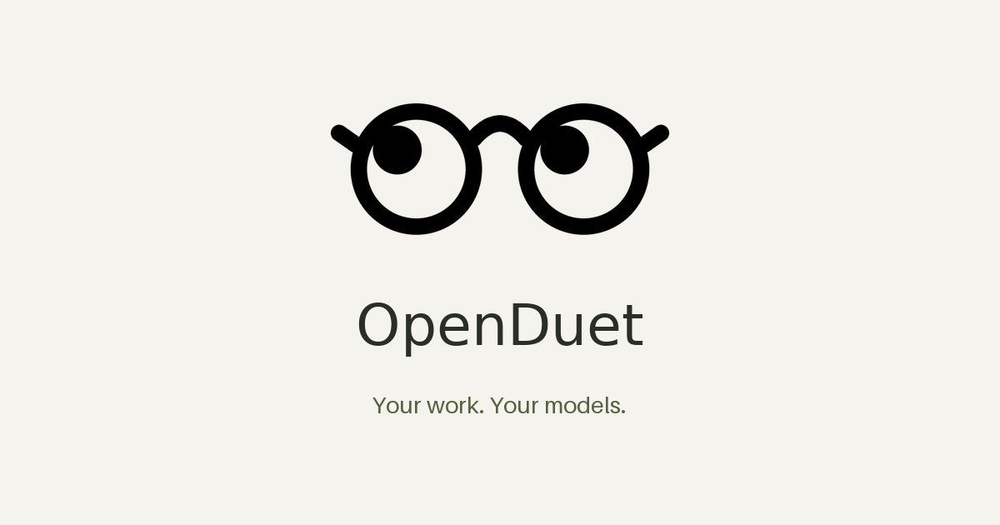

<p align="center"></p>

# OpenDuet

Your own proactive assistant, on Telegram. Open source, self-hosted, and usable
with local models as well as hosted APIs.

Give it work in a message or a voice note. It reads connected sources, prepares
reply drafts and meeting notes, creates documents, spreadsheets, slide decks and
dashboards, and asks you to review external actions. Kev makes typed attention
decisions independently of the model you choose for writing and tool use.

On a Mac, enable on-demand application access: ask the agent to open an installed
app, inspect its controls, interact with it after approval, or send a screenshot
on Telegram. The Mac must be awake and OpenDuet running. No screen-sharing server
is needed. A separate isolated browser handles websites without a connector.

## Install on your Mac

[Mac quickstart](docs/QUICKSTART-MAC.md) installs a private background service,
opens a one-use local sign-in and guides Telegram, model verification and Mac permissions.

## Run locally

Python 3.12+ and [uv](https://docs.astral.sh/uv/) are required.

```sh
git clone https://github.com/gabrielekarra/openDuet.git
cd openDuet
uv sync --locked
cp openduet.toml.example openduet.toml
export OPENDUET_TOKEN="$(openssl rand -hex 32)"
uv run openduet --config openduet.toml
```

Open <http://127.0.0.1:8765>, sign in with your workspace token, and follow the
Telegram setup page. Create your own bot with @BotFather, paste its token, then
open the single-use, ten-minute pairing link in your private Telegram account.
Only the paired owner can issue commands. Bot tokens are encrypted at rest.

Configure your model in Settings. Ollama, LM Studio, llama.cpp, vLLM and other
OpenAI-compatible servers work without a hosted API key. Native Ollama and
Anthropic adapters are also included. Models without native tool calls can use
the validated text protocol. Model reasoning, context length and tool/vision
capabilities still determine what an assignment can accomplish.

On macOS, install the bridge and enable it in Settings:

```sh
uv sync --locked --extra mac
uv run --no-sync openduet --config openduet.toml
```

Grant Accessibility and Screen Recording to the Python/terminal running
OpenDuet. Send `/apps`, `/screen`, or a natural-language request through Telegram.
See [Mac access](docs/REMOTE-ACCESS.md).

## Always-on server

```sh
cp .env.example .env
# Replace both placeholder tokens with independently generated random secrets.
docker compose up -d --build
```

Compose starts the workspace, isolated Chromium computer, enforcing egress proxy,
a separate prototype origin and the Kev CPU service. SQLite and connector/provider credentials stay
outside the computer container. LibreOffice recalculates generated financial
models and renders slide previews in the workspace image.

[Self-hosting](docs/SELF-HOSTING.md) covers local models, HTTPS, Kev model setup,
voice input, persistent volumes, backup and the VPS cloud-init template. You can
use Telegram with an outbound connection only. A public HTTPS origin is needed
only for OAuth callbacks, payment authorization webhooks or the optional Mini App.

## Included workflows

- Daily morning brief, optional evening report, quiet hours, VIP/never rules,
  confidence floors, interruption caps and reversible learning.
- Durable tasks, shared channels/memory, exact-payload approvals, editing,
  deferral, expiry, receipts and uncertain-outcome review.
- Telegram messages, bounded photos/documents/audio, local transcription,
  optional vision models, file delivery, revision replies and quick choices.
- Versioned DOCX/PDF/PPTX/XLSX deliverables, live spreadsheet formulas,
  declarative dashboards and sandboxed web prototypes.
- Curated connector directory, MCP discovery, OAuth with PKCE, declarative
  Agent Skills/plugins and business workflow recipes.
- Direct TLS email with app-password setup, read-only polling and optional
  exact-payload approved sends, including iCloud STARTTLS.
- Encrypted secret storage, optional dedicated password managers and optional
  purchase-scoped Stripe Issuing cards for eligible issuer accounts.

Details: [architecture](docs/ARCHITECTURE.md), [proactivity](docs/PROACTIVITY.md),
[connectors](docs/CONNECTORS.md), [plugins](docs/PLUGINS.md),
[Make](docs/MAKE.md), [security boundaries](docs/SECURITY.md).

## Validation and scope

The current release is **0.4.0rc1**, with a [Mac installer guide](docs/QUICKSTART-MAC.it.md)
and a public versioned source archive. Verified wheels and checksums are available
in the [distribution workflow](https://github.com/gabrielekarra/openDuet/actions/workflows/release.yml).
Automated tests use disposable bot/provider/issuer
transports; real Chromium and LibreOffice checks exercise their actual runtimes.
See the [issue acceptance tracker](docs/IMPLEMENTATION-TRACKER.md) for evidence
and outstanding live-account/hardware/model checks. The fixture Kev benchmark
checks adapters and policy; it does not measure model accuracy. A separate
scheduled/manual workflow runs the pinned real model. Actual local-model work,
Mac login-service recovery and passing CPU/MLX attention benchmarks are recorded
in [validation](docs/VALIDATION.md), including memory, latency and remaining
live-device/account checks.

OpenDuet is independent of Anthropic. The [Claude Duet research](docs/CLAUDE-DUET-RESEARCH.md)
links public sources and records capability differences, including proprietary
Link/Shop Pay services that require separate provider agreements. The native
predecessor is preserved under `bobb-mac-final`; current setup and
[migration](docs/MIGRATION.md) use the portable runtime.

MIT licensed. [Third-party notices](THIRD_PARTY_NOTICES.md).
