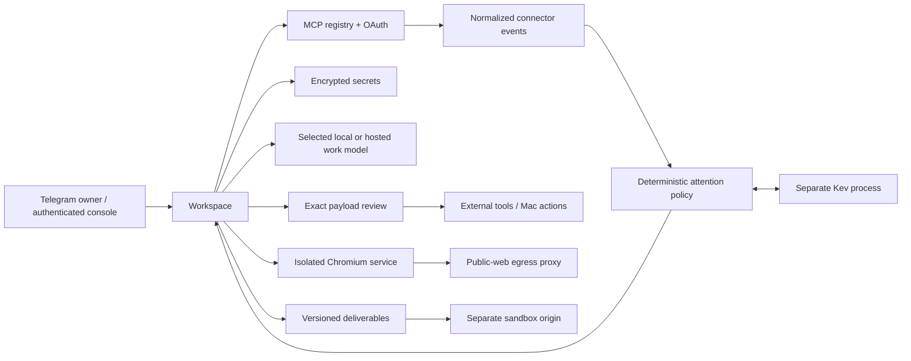

# Architecture

OpenDuet has one task owner and one SQLite database. The FastAPI process serves
the console and runs a bounded work queue. Telegram and the web console create
and review the same tasks, messages, tool calls and artifact versions.

The work model proposes tool calls. The host validates schema, availability,
disclosure policy and review requirements before executing them. Decisions bind
the exact stored arguments. Editing creates a new pending payload; deferring
allows independent work to continue. Replayed reviews cannot execute an action
twice. An interrupted external call becomes uncertain, requiring verification.

Proactivity is a separate background loop. Read-only MCP poll tools ingest
versioned events with durable cursors and content hashes. Kev answers only typed
Bool/Score/Choice questions; host policy chooses ignore, brief, prepare, silent
notification or interruption using the weakest confidence actually used. The
optional personal specialist can suppress confidently unimportant events only
after held-out validation. Selected work goes to the ordinary work model.

The browser computer has its own token, browser profile and container. It has no
workspace database, model keys or connector credentials. Its only external route
is the egress proxy. Public reads are allowed; interactions require review.
Private sign-in resolves credentials at the transport edge, outside model
history. Reading a website still treats its content as untrusted data.

On the user's Mac, the optional Python bridge performs on-demand Accessibility
queries and screen captures. It binds actions to a fresh snapshot and foreground
process. There is no continuous OCR/AX sensor, screen memory or VNC server.

Artifacts retain parents and versions. Financial models have validated live
formulas; LibreOffice can recalculate and detect errors. Slide previews use the
native converter when available. Dashboards are declarative JSON. Prototypes
run on a separate origin in opaque sandbox frames with network access disabled.

Files: `runtime.py` owns work; `telegram.py` owns transport; `attention.py` owns
proactivity; `kev/` owns typed readouts; `registry.py` owns account connections;
`vault.py` owns secrets; `make.py` owns deliverables; `computer.py` and `egress.py`
are separate services. The console is static ES modules and has no build step.
